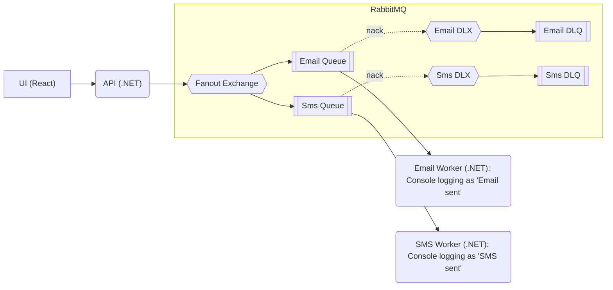

# rabbitmq-demo

> [!NOTE]
> This is a **learning/demo project** showcasing RabbitMQ messaging patterns with .NET.
> See [Possible Enhancements](#possible-enhancements) for known gaps and planned improvements.

A **learning-oriented** .NET 10 demo application using RabbitMQ for message brokering with an API, email/SMS workers, and a React UI.



## Prerequisites

- [Docker](https://docs.docker.com/get-docker/)
- [.NET 10 SDK](https://dotnet.microsoft.com/download/dotnet/10.0)
- [Node.js](https://nodejs.org/) and [pnpm](https://pnpm.io/) (for the UI and the app host)
- [.NET Aspire CLI](https://learn.microsoft.com/dotnet/aspire/get-started/tooling) (`aspire` command)

## Run Locally

### Everything at once (Aspire app host)

```bash
cd aspire-apphost
pnpm install
pnpm run dev
```

This starts RabbitMQ, the API, both workers, and the UI, and opens the Aspire dashboard, which lists every service, its endpoint URLs, and its logs.

A few notes on the ports in this mode:

- The **UI is pinned to `http://localhost:5173`** so the URL is stable and bookmarkable. Set `UI_PORT` to move it (e.g. `UI_PORT=5273 pnpm run dev`), which is also how you run a second stack alongside this one.
- The **API and RabbitMQ ports are allocated dynamically** — read them from the dashboard rather than assuming a fixed port. In particular the RabbitMQ management UI is *not* on `15672` in this mode.
- The API's own port is fixed by the `http` launch profile (`app/api/src/Properties/launchSettings.json`); the Aspire dashboard shows the proxied address to use.
- End-to-end tests need no configuration: `e2e/playwright.config.ts` defaults to `http://localhost:5173`, which is the pinned UI port.

### Running services individually

Use this when you want to run a single service in isolation, or to step through the wiring by hand. Note that this path uses `docker compose` and therefore *different* ports than the Aspire mode above.

#### 1. Start RabbitMQ

```bash
docker compose up -d
```

RabbitMQ management UI will be available at `http://localhost:15672` (user: `user`, password: `password`).

#### 2. Run the API

```bash
cd app/api/src
dotnet run
```

The API starts at `http://localhost:5139`.

#### 3. Run the Workers

In separate terminals:

```bash
# Email worker
cd app/email-worker/src
dotnet run
```

```bash
# SMS worker
cd app/sms-worker/src
dotnet run
```

#### 4. Run the UI

```bash
cd app/ui
pnpm install
pnpm run dev
```

The UI starts at `http://localhost:5173`. Open it in your browser, fill in the form, and submit a message.

### Distributed Tracing

The API creates HTTP and RabbitMQ publish spans; the email and SMS workers create consumer spans. W3C trace context is carried in RabbitMQ headers, so each worker's processing span appears as a child of the publish span.

When running through the Aspire app host, open the Aspire dashboard's **Traces** view to inspect a submitted message's trace across the API and workers. When running services individually, set `OTEL_EXPORTER_OTLP_ENDPOINT` in each service's environment to an OTLP collector endpoint (for example, `http://localhost:4317`). Standalone services export traces only when this variable is set.

### Verify

Look at the console logs of the API and workers to confirm messages are being published and processed.

## Running Tests Locally

### Backend (unit & integration)

```bash
# Run all backend tests
cd app
dotnet test

# Or run individually
cd app/api/tests && dotnet test
cd app/email-worker/tests && dotnet test
cd app/sms-worker/tests && dotnet test
```

Requires Docker — the integration tests use Testcontainers to spin up a real RabbitMQ instance.

### UI

```bash
cd app/ui
pnpm test
```

### End-to-End

```bash
cd e2e
pnpm test
```

Requires the app to be running locally. Works against either run mode: the Aspire app host
serves the UI on the pinned `http://localhost:5173`, which is what `e2e/playwright.config.ts`
defaults to. Set `E2E_BASE_URL` to point the tests at a different address.

## Possible Enhancements

- **Unroutable message handling** — the API publishes with `mandatory: false`, so messages with no matching queue binding are silently dropped by the broker with no signal to the publisher; enabling `mandatory: true` plus a `BasicReturnAsync` handler would surface these
- **Publisher confirms** — no `ConfirmSelectAsync`/`WaitForConfirmsOrDieAsync` yet, so the API can't verify the broker actually accepted a published message
- **Durable idempotency** — the API assigns each message an `Id` and workers skip already-processed messages (a `SemaphoreSlim` in each handler also makes the check-then-store path safe against concurrent identical deliveries), but dedup state lives in an in-memory `ProcessedMessageStore`; a worker restart loses it, so a redelivered message after a restart could still produce a duplicate email/SMS — a persistent store (e.g. Redis or a database) would close this gap
- **Retries for the workers** — failed messages currently dead-letter on first failure for both email and SMS workers; retries (in-process loop or a TTL retry queue) before parking them would be the next step
- **Connection resilience** — API and workers create a single connection at startup with no reconnection if RabbitMQ goes down
- **API validation** — no input validation or error responses beyond a 200 OK
- **UI error handling** — only checks `response.ok`; no loading state, no error display
- **Processing status in the UI** — there's no way to see whether workers actually processed a submitted message; you have to check the workers' console logs. Publishing a "message processed" event back to the API (or having the API poll worker state) and showing per-message status in the UI would close this loop